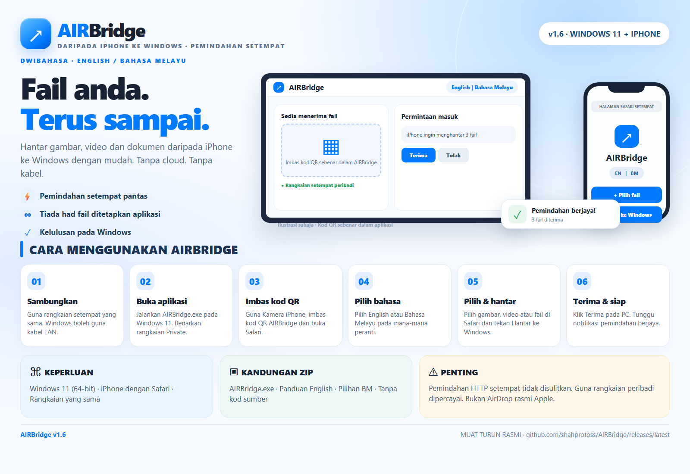

# AIRBridge — Cara Penggunaan (Bahasa Melayu)

AIRBridge memindahkan foto, video dan dokumen daripada iPhone ke Windows
melalui Safari menggunakan rangkaian setempat yang sama. Aplikasi ini **bukan
AirDrop rasmi Apple**.

## Keperluan

- PC Windows 11 (64-bit), iPhone dengan Safari dan Kamera.
- iPhone dan PC pada rangkaian setempat yang sama. PC boleh menggunakan
  **kabel LAN** manakala iPhone menggunakan Wi-Fi.
- Ruang storan yang mencukupi untuk fail yang diterima.

## Langkah penggunaan

1. **Muat turun AIRBridge** melalui
   [GitHub Releases](https://github.com/shahprotoss/AIRBridge/releases/latest).
   Pilih **AIRBridge-v1.6-Windows.zip**, klik kanan dan **Extract All**.
   Fail **AIRBridge.exe** juga boleh dimuat turun secara berasingan.
2. **Buka AIRBridge.exe** pada Windows. Jika Windows Firewall bertanya,
   benarkan rangkaian **Private** sahaja.
3. **Pilih bahasa** pada aplikasi Windows: **English** atau **Bahasa Melayu**.
   Pilihan anda akan disimpan.
4. **Imbas kod QR** dalam AIRBridge menggunakan Kamera iPhone dan buka pautan
   tersebut dalam Safari. Jangan kongsikan pautan tersebut secara terbuka.
5. **Pilih bahasa pada Safari**, tekan **Pilih fail**, tandakan gambar,
   video atau dokumen dan tekan **Hantar ke Windows**.
6. **Klik Terima** pada permintaan masuk dalam aplikasi AIRBridge di Windows.
7. **Tunggu hingga selesai.** Safari memaparkan kemajuan dan kelajuan.
   AIRBridge kemudian memaparkan notifikasi **Pemindahan berjaya!**.
   Klik **Buka fail diterima** untuk melihat fail.

## Folder simpanan dan pilihan bahasa

- Secara lalai, pemasangan baharu menyimpan fail dalam **Downloads\\AIRBridge**.
- Gunakan butang **Tukar** untuk memilih folder lain. Folder lama pengguna
  DropBridge akan dikekalkan secara automatik selepas naik taraf.
- Bahasa English dipaparkan secara lalai untuk pengguna baharu. Bahasa
  Melayu boleh dipilih melalui suis bahasa pada aplikasi Windows atau Safari.
- Bahasa Windows dan Safari diingati secara berasingan. Sambungan Safari
  pertama mengikuti bahasa Windows jika iPhone belum mempunyai pilihan.

## Keselamatan dan had praktikal

- Tiada had bilangan atau jumlah saiz fail yang ditetapkan oleh aplikasi;
  had sebenar bergantung pada peranti, Safari, storan dan rangkaian.
- Biarkan Safari terus terbuka semasa pemindahan berlangsung.
- Pemindahan menggunakan HTTP tanpa penyulitan. Gunakan rangkaian peribadi
  dipercayai sahaja, bukan Wi-Fi awam.
- Jangan dedahkan port AIRBridge ke internet.
- Pemindahan perlu diluluskan pada Windows terlebih dahulu.
- AIRBridge bukan aplikasi AirDrop asli dan bukan produk Apple.

