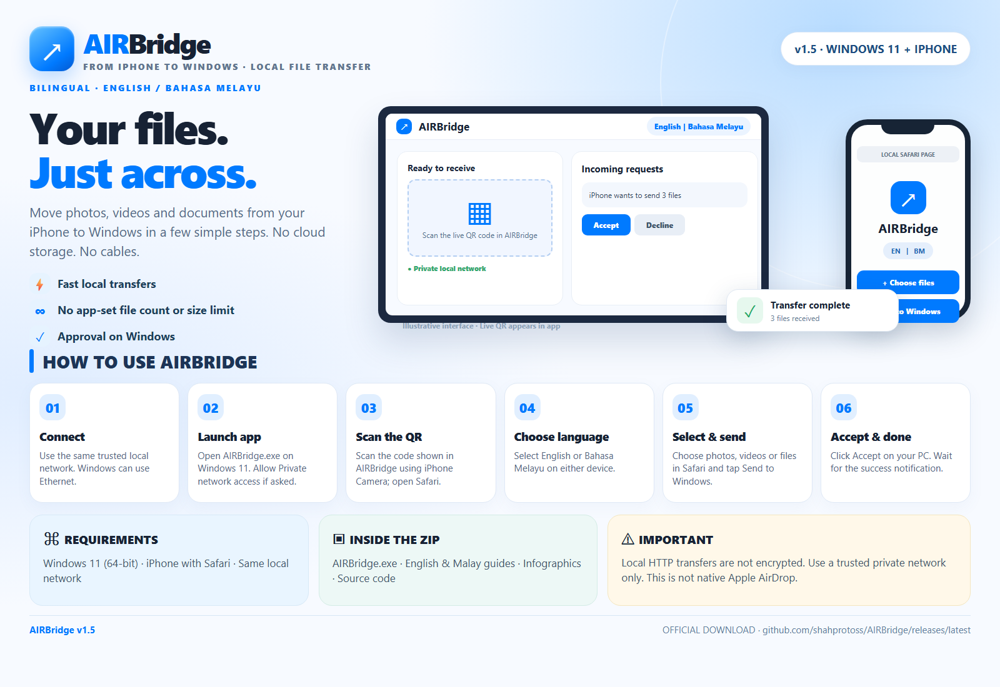

# AIRBridge — How to Use (English)

AIRBridge transfers photos, videos, and documents from your iPhone to a Windows
PC using Safari over the same **trusted local network**. It is a local-network
alternative, **not** Apple's native AirDrop protocol.

## Requirements

- A Windows 11 PC (64-bit).
- An iPhone with Safari and a camera.
- The iPhone and PC on the same reachable local network. The PC may connect
  using **Ethernet**, while the iPhone uses Wi-Fi.
- Enough available disk space for the incoming files.

## Step-by-step guide

1. **Download AIRBridge** from the
   [latest GitHub Release](https://github.com/shahprotoss/AIRBridge/releases/latest).
   Download **AIRBridge-v1.5-Pakej-Lengkap.zip** and choose **Extract All**.
   You can also download **AIRBridge.exe** on its own.
2. **Open AIRBridge.exe** on your Windows PC. If Windows Firewall asks,
   allow it for **Private networks only**. Keep AIRBridge open while receiving.
3. **Choose your language:** select **English** or **Bahasa Melayu** at the
   top of the Windows application. Your choice is remembered.
4. **Scan the QR code** shown inside AIRBridge using the iPhone Camera. Tap
   the link to open the sender page in Safari. You can also copy the pairing
   link from the Windows application. Do not share it publicly.
5. **Select your language on iPhone,** then tap **Choose files** and select
   the photos, videos or documents you want to transfer. Tap **Send to Windows**.
6. **Approve the transfer:** return to the AIRBridge window on your PC and
   click **Accept** to approve the incoming batch.
7. **Wait for the confirmation.** Safari shows transfer progress and speed.
   When all selected files arrive, Windows shows a **Transfer complete!**
   notification in AIRBridge. Click **Open received files** to see them.

## Save location

By default, a fresh installation saves files to
**Downloads\\AIRBridge**. To change the destination, click **Change**
inside AIRBridge. If you upgraded from DropBridge, your existing save
directory is preserved automatically.

## Bilingual preferences

- **Windows:** Select **English / Bahasa Melayu** in the top bar; the
  preference is saved to the PC settings.
- **iPhone:** Select **English / Bahasa Melayu** on the Safari sender page;
  its preference is remembered independently on the iPhone.
- The first Safari visit follows the Windows language when the iPhone has
  no previously selected language.

## Performance and limitations

- AIRBridge does not impose an application-level limit on the number or total
  size of selected files. Actual limits still depend on your device, browser,
  network, storage space and filesystem.
- Keep Safari open and active during transfers.
- The browser uploads in 16 MiB chunks, with up to three different files
  transferred concurrently.
- Windows must approve each batch before the upload starts.
- Network transfers use plain **HTTP** on your local network and are **not
  encrypted**. Use only a trusted private network, not public Wi-Fi.
- Do not configure port forwarding or expose AIRBridge to the internet.
- This application is not affiliated with Apple and is not native AirDrop.
- The Windows executable is not digitally signed, so Windows SmartScreen may
  warn about an unknown publisher.

## Troubleshooting

- **QR page will not open:** Check that both devices are on the same network;
  VPNs, guest Wi-Fi, client isolation and Windows Firewall can block access.
- **Upload is slow:** Keep devices on a strong 5 GHz Wi-Fi connection when
  possible; the PC can use Ethernet on the same router.
- **Nothing happens after choosing files:** Switch to the Windows application
  and click **Accept** for the pending transfer.
- **Windows notification is missing:** AIRBridge's in-app completion message
  still works. Check Windows notification and Do Not Disturb settings.

