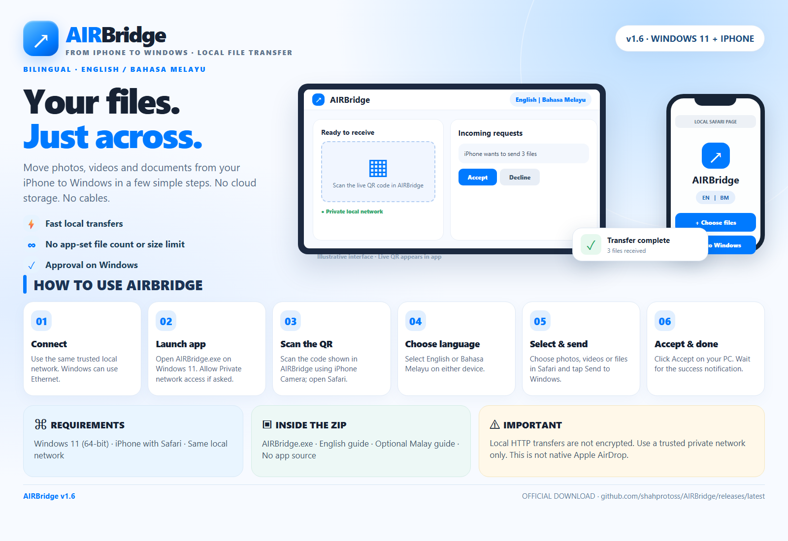
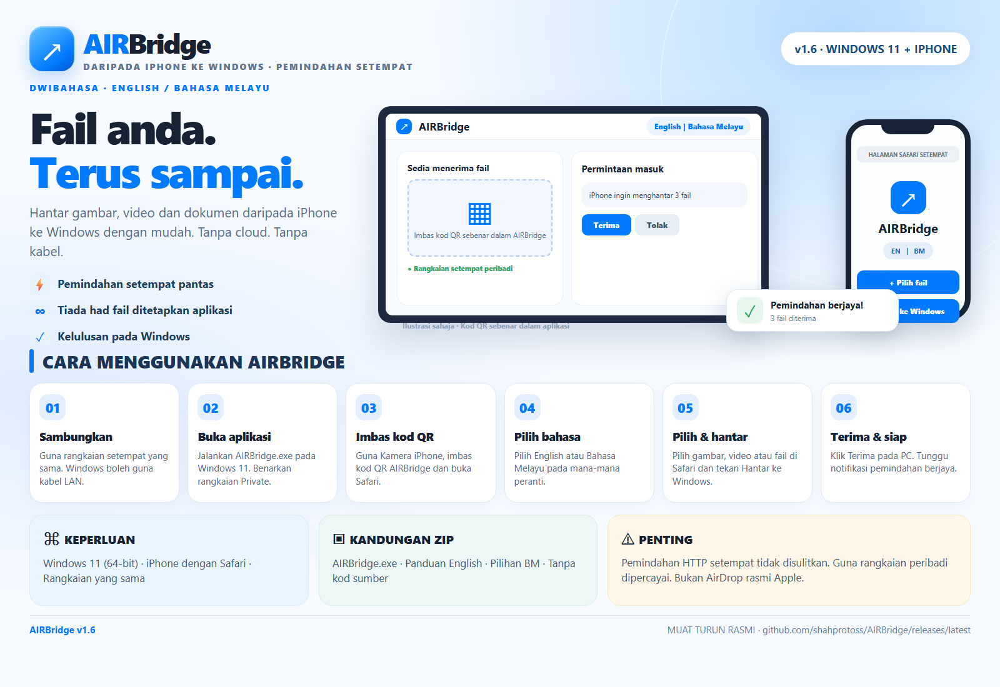

# AIRBridge — Transfer Files from iPhone to Windows

**Fast local file transfer. English by default. Bahasa Melayu available.**

Send photos, videos and documents from iPhone Safari to a Windows PC over the
same trusted local network. No cloud account, subscription or cable required.
AIRBridge is a local-network alternative, **not native Apple AirDrop**.

## Download AIRBridge for Windows

**[Download the latest version — GitHub Releases](https://github.com/shahprotoss/AIRBridge/releases/latest)**

Choose one of the official Windows application downloads:

| Download | What you get |
| --- | --- |
| **AIRBridge-v1.6-Windows.zip** | **Recommended:** AIRBridge.exe, English quick-start and guide, illustrated English instructions, and optional Bahasa Melayu guides. **No application source code in this ZIP.** |
| **AIRBridge.exe** | Windows application only, ready to launch |

**Important:** To install AIRBridge, choose the official **AIRBridge.exe** or
**AIRBridge-v1.6-Windows.zip** release asset. The automatic GitHub
**Source code (zip)** and **Source code (tar.gz)** archives are not application
installers.

## How to Use AIRBridge (English)

1. **Connect devices:** Make sure your iPhone and Windows PC can reach each
   other on the same private local network. The PC can use Ethernet.
2. **Launch:** Extract the ZIP, if needed, and open **AIRBridge.exe** on
   Windows 11. Allow Windows Firewall on **Private networks only**.
3. **Scan:** Open iPhone Camera, scan the live QR code in AIRBridge and tap
   the link to open Safari.
4. **Choose language:** English is the default. Select **Bahasa Melayu** on
   Windows or Safari if you prefer Malay.
5. **Send files:** Tap **Choose files** and **Send to Windows** in Safari.
6. **Approve and finish:** Click **Accept** on Windows. Wait for the
   **Transfer complete!** notification, then click **Open received files**.

[Read the detailed English user guide](GUIDE_EN.md).

## Bahasa Melayu (optional / pilihan)

Pilih **Bahasa Melayu** pada aplikasi Windows atau halaman Safari untuk
menggunakan antaramuka dalam Bahasa Melayu. Setiap peranti mengingati
pilihan bahasa selepas anda menukarnya.

[Baca panduan Bahasa Melayu](GUIDE_BM.md).

## Highlights

- English is the default; Bahasa Melayu can be selected at any time.
- Modern Windows desktop interface and iPhone Safari sender.
- QR pairing and Windows approval for every incoming transfer.
- Transfer speed and progress display, with success notifications.
- Uses 16 MiB upload chunks and up to three concurrent files.
- No **application-configured** limit on file count, individual file size or
  batch size. Practical browser, device, network and storage limits still apply.
- Local transfer; no cloud server.

## System requirements

- Windows 11 (64-bit), iPhone with Safari and Camera.
- Both devices must be reachable on the same trusted private network.
- Adequate destination storage space.
- No Python installation required for the pre-built AIRBridge.exe.

## Security and limitations

AIRBridge transfers files over **unencrypted HTTP** on your local network.
Use only a trusted private network. Do not expose the application via
internet port forwarding. The pairing link is private and transfers require
approval from the Windows app. Keep Safari open until the transfer ends.

This is **not** native Apple AirDrop. AIRBridge is not affiliated with Apple.
The executable is currently not code-signed; Windows SmartScreen may display
an unknown publisher notice.

## Maintainer note

The user-facing Windows ZIP is deliberately limited to the application and
instructions; it does **not** include raw application source files.
