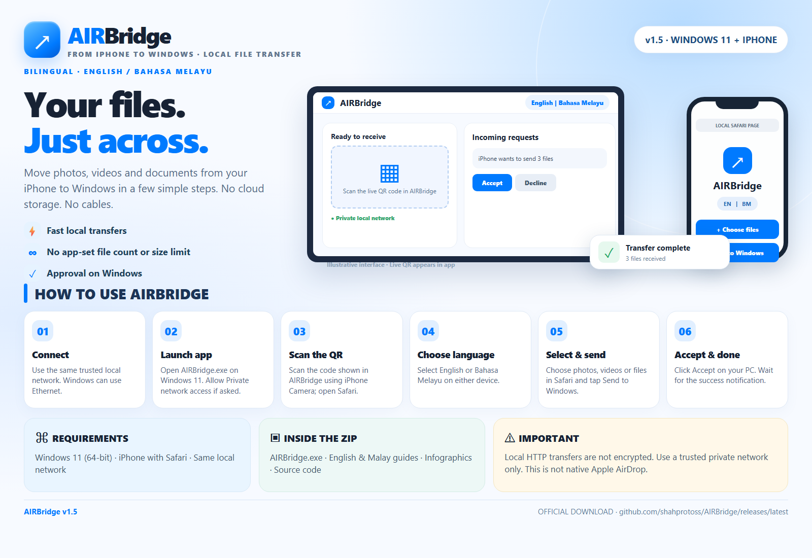

# AIRBridge v1.5 — English & Bahasa Melayu Guides

**Send photos, videos and documents from iPhone to Windows over a trusted local network.** AIRBridge provides a polished Windows interface and an iPhone Safari upload page in **English or Bahasa Melayu**. No account, subscription or cloud upload is required.

## Download / Muat turun

| File | Description |
| --- | --- |
| [AIRBridge-v1.5-Pakej-Lengkap.zip](https://github.com/shahprotoss/AIRBridge/releases/download/v1.5/AIRBridge-v1.5-Pakej-Lengkap.zip) | **Recommended.** Windows EXE, English & Malay infographics, user guides and source code |
| [AIRBridge.exe](https://github.com/shahprotoss/AIRBridge/releases/download/v1.5/AIRBridge.exe) | Standalone Windows 11 application (no Python installation needed) |
| [AIRBridge-Guide-EN.png](https://github.com/shahprotoss/AIRBridge/releases/download/v1.5/AIRBridge-Guide-EN.png) | Illustrated English setup guide |
| [AIRBridge-Guide-BM.png](https://github.com/shahprotoss/AIRBridge/releases/download/v1.5/AIRBridge-Guide-BM.png) | Panduan bergambar Bahasa Melayu |

## How to use AIRBridge (English)

1. **Connect your devices** to the same trusted local network. The Windows PC may use Ethernet; the iPhone uses Wi-Fi.
2. **Launch `AIRBridge.exe`** on Windows 11. Allow access on **Private networks only** if Windows Firewall prompts you.
3. **Scan the QR code** shown by AIRBridge with your iPhone Camera and open the link in **Safari**.
4. **Choose your language** using the **English / Bahasa Melayu** switch on the Windows app or Safari page. Each device remembers its choice.
5. **Select and send files** in Safari. Tap **Choose files**, select your photos, videos or documents, and tap **Send to Windows**.
6. **Approve the transfer on the PC** by clicking **Accept**. Wait for the transfer to complete and the **Transfer complete!** notification.
7. Click **Open received files** to see the files. Use **Change** to select a different destination folder.

Detailed instructions: [English User Guide](https://github.com/shahprotoss/AIRBridge/blob/v1.5/GUIDE_EN.md).

## Cara menggunakan AIRBridge (Bahasa Melayu)

1. Sambungkan kedua-dua peranti pada rangkaian setempat yang sama.
2. Jalankan **AIRBridge.exe** pada Windows 11. Benarkan rangkaian **Private** sahaja.
3. Imbas kod QR pada aplikasi Windows menggunakan Kamera iPhone dan buka pautan dalam Safari.
4. Pilih **Bahasa Melayu** pada Windows atau Safari.
5. Pilih gambar, video atau dokumen dan tekan **Hantar ke Windows**.
6. Tekan **Terima** pada aplikasi Windows. Tunggu notifikasi **Pemindahan berjaya!**.
7. Klik **Buka fail diterima** untuk melihat fail yang diterima.

Panduan lengkap: [Panduan Bahasa Melayu](https://github.com/shahprotoss/AIRBridge/blob/v1.5/GUIDE_BM.md).

## What's new in v1.5

- New English and Bahasa Melayu illustrated infographics with accurate instructions and download information.
- Expanded English and Malay step-by-step guides in the GitHub repository and ZIP.
- Better release page with quick-start instructions for both languages.
- Retains bilingual Windows/Safari menus, persistent language preferences, approval, progress, and notifications from v1.4.
- Retains fast local transfer mode: 16 MiB chunks and up to three files in parallel, without an application-configured file count or total size limit.

## Requirements & security notes

- Windows 11 (64-bit), iPhone with Safari, same reachable private local network, and sufficient storage.
- **Transfers use plain HTTP and are not encrypted.** Use a trusted private home/office network, not public Wi-Fi. Never port-forward AIRBridge to the internet.
- This is **not native Apple AirDrop**, does not appear in the iPhone AirDrop menu, and is not affiliated with Apple.
- The EXE is not digitally signed; Windows may show a SmartScreen warning.
- Native Windows notifications may be limited by notification settings; the in-app completion popup remains available.
- Practical file-transfer limits may depend on the device, browser, network, filesystem and storage.
